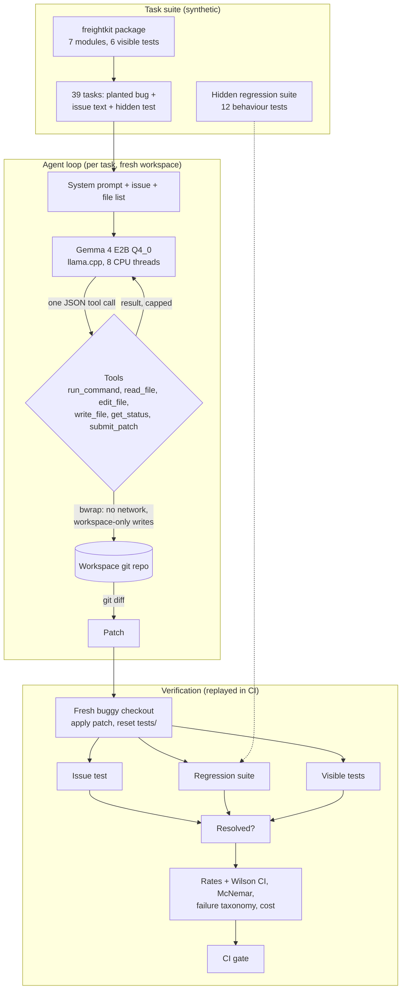

# Gemma 4 as a coding agent on CPU: what the agent loop adds, measured

A coding agent built on Gemma 4 E2B (the smallest Gemma 4 model, 4-bit) fixes reported bugs in the
code base of a fictional road-freight company, Tallowmere Freight, running entirely on an 8-core CPU.
Every patch is checked on a fresh checkout against tests the agent never saw. The same model is
compared with and without the agent loop, with a weaker prompt, and against a non-Gemma model of
similar size. All issues and code are synthetic; every number below was measured once and is replayed
in CI.

## Recruiter summary

- **Problem:** a coding agent is only useful if its fixes are real. Small open models are cheap to run
  privately, but it is unclear what they can fix, how they fail, and whether the agent loop (run the
  tests, search, read, edit, re-test) is worth its cost over asking once.
- **Approach:** 39 synthetic issues planted in a 7-module Python package, each with a hidden test, plus
  a hidden whole-package regression suite. A sandboxed tool layer (bubblewrap, no network, workspace-only
  writes, budgets) and a plain JSON tool protocol. Gemma 4 E2B Q4_0 through llama.cpp on CPU.
- **Proof (measured, 39 tasks):** the agent resolved **43.6%<!-- m:configs/gemma4-e2b.workflow/resolved/rate -->**
  of issues (17<!-- m:configs/gemma4-e2b.workflow/resolved/k -->/39); the same model asked once with the whole code
  in view resolved 28.2%<!-- m:configs/gemma4-e2b.oneshot/resolved/rate -->. When the agent ran the tests it
  resolved 57.1%<!-- m:configs/gemma4-e2b.workflow/resolved_when_ran_tests/rate -->, against
  9.1%<!-- m:configs/gemma4-e2b.workflow/resolved_when_no_tests/rate --> when it did not. An issue-test-only grader
  would have reported 48.7%<!-- m:configs/gemma4-e2b.workflow/issue_test_only/rate -->.
  <!-- tests -->87<!-- /tests --> tests, CI green.

## Purpose and who it is for

- **Engineering leads** deciding whether a small private model can take on routine bug fixes, and what
  to check before trusting it.
- **AI engineers** who want a small, readable agent harness: tools, sandbox, budgets, verification,
  failure taxonomy, paired comparisons.
- **Platform teams** planning the same evaluation on a GPU in Azure ML / Microsoft Foundry (written,
  not run).

This is a reference implementation on a small synthetic suite. It shows a method and real measurements
for this setup; it is not a benchmark score and does not predict results on large real repositories.

## Architecture



## How it works, step by step

1. **Code base.** `fixtures/freightkit` is a small freight package: unit conversions and chargeable
   weight, postcode clean-up, zone and band pricing with surcharges, manifest parsing, dock slot
   booking, and consignment tracking with working-day promises.
2. **Tasks.** `sweval/tasks.py` plants one bug per task (an exact text edit) and writes the issue the
   way a colleague would: 13 name the function, 23 only describe the symptom, 3 need more than one
   change. `scripts/validate_tasks.py` proves each hidden test fails before and passes with the fix.
3. **Workspace.** For each task the package is copied, the bug planted, and a git baseline committed.
   The model sees the issue, the file list and its budget (12 tool calls, 14 turns).
4. **Agent loop.** Each turn the model writes one sentence and one JSON tool call. The tool layer runs
   it inside bubblewrap or refuses it, caps the output, and returns the result. The run ends on
   `submit_patch`, the turn limit, three replies without a tool call, or a full context.
5. **Verification.** The patch is applied to a fresh buggy checkout; any edits to tests are reset; the
   issue's hidden test, the hidden regression suite and the visible tests run. Resolved means all three
   pass.
6. **Comparisons.** The same tasks with the basic prompt, with no loop at all (one shot, whole source in
   the prompt), and with Qwen2.5 1.5B; reference patches (must be 100%) and empty patches (must be 0%)
   check the harness itself.

## Results (measured, synthetic tasks)

Rates show k/n; Wilson 95% intervals are in the [full report](results/report.md). Gemma 4 E2B means the
official quantization-aware Q4_0 weights on CPU.

| Configuration | Resolved | Named-function issues | Symptom-only issues | Ran the tests | Median seconds per task |
|---|---|---|---|---|---|
| Gemma 4 E2B, agent loop, workflow prompt | **43.6%<!-- m:configs/gemma4-e2b.workflow/resolved/rate -->** | 53.8%<!-- m:configs/gemma4-e2b.workflow/by_kind/named/rate --> | 34.8%<!-- m:configs/gemma4-e2b.workflow/by_kind/symptom/rate --> | 71.8%<!-- m:configs/gemma4-e2b.workflow/ran_tests/rate --> | 65.1<!-- m:configs/gemma4-e2b.workflow/cost/seconds_p50 --> |
| Gemma 4 E2B, agent loop, basic prompt | 20.5%<!-- m:configs/gemma4-e2b.basic/resolved/rate --> | 30.8%<!-- m:configs/gemma4-e2b.basic/by_kind/named/rate --> | 17.4%<!-- m:configs/gemma4-e2b.basic/by_kind/symptom/rate --> | 0.0%<!-- m:configs/gemma4-e2b.basic/ran_tests/rate --> | 100.4<!-- m:configs/gemma4-e2b.basic/cost/seconds_p50 --> |
| Gemma 4 E2B, one shot (no tools, whole source in prompt) | 28.2%<!-- m:configs/gemma4-e2b.oneshot/resolved/rate --> | 38.5%<!-- m:configs/gemma4-e2b.oneshot/by_kind/named/rate --> | 21.7%<!-- m:configs/gemma4-e2b.oneshot/by_kind/symptom/rate --> | n/a | 43.0<!-- m:configs/gemma4-e2b.oneshot/cost/seconds_p50 --> |
| Qwen2.5 1.5B, agent loop, workflow prompt | 0.0%<!-- m:configs/qwen2.5-1.5b.workflow/resolved/rate --> | 0.0%<!-- m:configs/qwen2.5-1.5b.workflow/by_kind/named/rate --> | 0.0%<!-- m:configs/qwen2.5-1.5b.workflow/by_kind/symptom/rate --> | 46.2%<!-- m:configs/qwen2.5-1.5b.workflow/ran_tests/rate --> | 25.3<!-- m:configs/qwen2.5-1.5b.workflow/cost/seconds_p50 --> |
| Reference patches (harness check) | 100.0%<!-- m:configs/oracle/resolved/rate --> | | | | |
| Empty patches (harness check) | 0.0%<!-- m:configs/noop/resolved/rate --> | | | | |

**Paired comparisons on the same 39 tasks** (exact McNemar test on the tasks where the two disagree):

| Comparison | Only the first solved | Only the second solved | p |
|---|---|---|---|
| Agent loop vs one shot (same model, same instructions) | 9<!-- m:paired/agent_vs_oneshot/only_first --> | 3<!-- m:paired/agent_vs_oneshot/only_second --> | 0.146<!-- m:paired/agent_vs_oneshot/mcnemar_p --> |
| Workflow prompt vs basic prompt (same loop) | 12<!-- m:paired/workflow_vs_basic/only_first --> | 3<!-- m:paired/workflow_vs_basic/only_second --> | 0.0352<!-- m:paired/workflow_vs_basic/mcnemar_p --> |
| Gemma 4 E2B vs Qwen2.5 1.5B (same loop and prompt) | 17<!-- m:paired/gemma_vs_qwen/only_first --> | 0<!-- m:paired/gemma_vs_qwen/only_second --> | < 0.001 |

**How the main agent failed** (one primary reason per unresolved task, from
[results/report.md](results/report.md)): wrong fix
8<!-- m:configs/gemma4-e2b.workflow/failures/wrong_fix -->, submitted without changing anything
{{configs/gemma4-e2b.workflow/failures/no_patch:submitted_empty|int}}, stopped producing tool calls
{{configs/gemma4-e2b.workflow/failures/no_patch:stopped_replying_with_tools|int}}, ran out of turns
{{configs/gemma4-e2b.workflow/failures/no_patch:out_of_turns|int}}, and fixed the issue's test by
breaking other behaviour 2<!-- m:configs/gemma4-e2b.workflow/failures/issue_test_passes_but_broke_other_behaviour -->.
It called a `grep` tool that does not exist 21<!-- m:configs/gemma4-e2b.workflow/unknown_tool_calls --> times
(the tool list offers `run_command` for that), and 44<!-- m:configs/gemma4-e2b.workflow/invalid_replies -->
replies had no tool call at all. It never edited a test.

**What this shows about agentic AI for this kind of work:**

- **The loop plus a good working method is what helps.** With the workflow prompt the agent resolved
  9<!-- m:paired/agent_vs_oneshot/only_first --> tasks the one-shot model missed and missed only
  3<!-- m:paired/agent_vs_oneshot/only_second --> it solved; with 39 tasks that difference is suggestive,
  not significant (p = 0.146<!-- m:paired/agent_vs_oneshot/mcnemar_p -->). The same loop with a one-line prompt did
  worse than one shot (20.5%<!-- m:configs/gemma4-e2b.basic/resolved/rate -->): it never ran the tests
  (0.0%<!-- m:configs/gemma4-e2b.basic/ran_tests/rate --> of tasks) and often wandered until the turn limit.
- **Running the tests is the step that matters.** Tasks where the agent ran the test suite were
  resolved 57.1%<!-- m:configs/gemma4-e2b.workflow/resolved_when_ran_tests/rate --> of the time
  (16<!-- m:configs/gemma4-e2b.workflow/resolved_when_ran_tests/k -->/28<!-- m:configs/gemma4-e2b.workflow/resolved_when_ran_tests/n -->),
  against 9.1%<!-- m:configs/gemma4-e2b.workflow/resolved_when_no_tests/rate -->
  (1<!-- m:configs/gemma4-e2b.workflow/resolved_when_no_tests/k -->/11<!-- m:configs/gemma4-e2b.workflow/resolved_when_no_tests/n -->)
  when it did not. This is an association: tasks it gave up on early are also tasks it never tested.
- **Symptom-only issues are harder**: 34.8%<!-- m:configs/gemma4-e2b.workflow/by_kind/symptom/rate --> against
  53.8%<!-- m:configs/gemma4-e2b.workflow/by_kind/named/rate --> when the issue names the function.
- **Model size and family matter more than anything else here.** Qwen2.5 1.5B in the same loop
  resolved nothing: it ran commands and then submitted without editing in
  {{configs/qwen2.5-1.5b.workflow/failures/no_patch:submitted_empty|int}} of 39 tasks.
- **Grade with more than the issue's test.** An issue-test-only grader would have reported
  48.7%<!-- m:configs/gemma4-e2b.workflow/issue_test_only/rate --> for the main agent instead of
  43.6%<!-- m:configs/gemma4-e2b.workflow/resolved/rate -->.
- **Dev and test:** 28.6%<!-- m:configs/gemma4-e2b.workflow/by_split/dev/rate --> on the 7 dev tasks and
  46.9%<!-- m:configs/gemma4-e2b.workflow/by_split/test/rate --> on the 32 test tasks, so the prompt was not
  tuned to the tasks it is scored on.

**Cost on CPU (8 cores, shared machine):** median 65.1<!-- m:configs/gemma4-e2b.workflow/cost/seconds_p50 --> s and
5.0<!-- m:configs/gemma4-e2b.workflow/cost/tool_calls_p50 --> tool calls per task, 37.6<!-- m:configs/gemma4-e2b.workflow/cost/seconds_p50_resolved --> s
for resolved tasks; 52.2<!-- m:configs/gemma4-e2b.workflow/cost/cpu_minutes_total --> minutes for all 39.

**Harness checks:** the visible tests catch only 8<!-- m:suite/bugs_caught_by_visible_tests --> of the 39 planted
bugs; the hidden regression suite catches 38<!-- m:suite/bugs_caught_by_regression_suite -->.

## Real code and its real output

The tool layer runs model commands in bubblewrap: system directories and the Python environment
read-only, the workspace the only writable place, no network (`sweval/sandbox.py`):

```python
            argv = ["bwrap", *ro_binds(), "--tmpfs", "/tmp", "--bind", str(self.root), "/tmp/workspace",
                    "--dev", "/dev", "--proc", "/proc", "--unshare-all", "--die-with-parent",
                    "--chdir", "/tmp/workspace", "bash", "-c", command]
```

Verification never trusts the agent: fresh checkout, tests reset, hidden tests added (`sweval/repo.py`):

```python
        git(d, "checkout", "HEAD", "--", "tests")
        git(d, "clean", "-fdq", "tests")
        (d / HIDDEN).write_text(task["tests"])
        (d / REGRESSION).write_text(SUITE)
```

A resolved multi-step issue, replayed and re-verified from the committed trajectory:

<!-- run: python examples/replay_one.py -->
```text
Issue (multi): Contract customers get their discount and fuel surcharge applied to the 25.00 remote-area fee. The fee is fixed: it is added last and never discounted or surcharged.

Agent gemma4-e2b.workflow: stop=submitted, turns=8, tool calls=5
  turn  1  grep         'remote-area fee'  ok=False
  turn  2  read_file    'freightkit/rates.py'  ok=True
  turn  3  (reply without a tool call)
  turn  4  read_file    'freightkit/rates.py'  ok=True
  turn  5  (reply without a tool call)
  turn  6  edit_file    'freightkit/rates.py'  ok=True
  turn  7  run_command  'python -m pytest -q'  ok=True
  turn  8  submit_patch ''  ok=True

Patch:
@@ -46,8 +46,8 @@ def quote(origin: str, dest: str, kg: float, contract_discount: float = 0.0) ->
     zone = zone_for(origin, dest)
     price = price_per_kg(zone, kg) * Decimal(str(kg))
     price = max(price, MINIMUM_CHARGE)
-    if postcode_area(dest) in REMOTE_AREAS:
-        price += REMOTE_FEE
     price = price * (1 - Decimal(str(contract_discount)))
     price = price * (1 + FUEL_SURCHARGE)
+    if postcode_area(dest) in REMOTE_AREAS:
+        price += REMOTE_FEE
     return price.quantize(Decimal("0.01"), rounding=ROUND_HALF_UP)

Verdict: applied=True issue_test_passed=True regression_suite_passed=True visible_suite_ok=True touched_tests=False
Resolved: True
```
<!-- /run -->

The shortcut the regression suite exists for. The model "fixed" a wrong conversion by changing the
shared constant, so the issue's test and the visible tests pass while `lb_to_kg` breaks:

<!-- run: python examples/replay_one.py units-kg-to-lb -->
```text
Issue (named): kg_to_lb(10) returns 4.54. Ten kilograms is about 22.05 pounds.

Agent gemma4-e2b.workflow: stop=submitted, turns=9, tool calls=7
  turn  1  read_file    'freightkit/units.py'  ok=True
  turn  2  edit_file    'freightkit/units.py'  ok=True
  turn  3  run_command  'python -m pytest -q'  ok=True
  turn  4  (reply without a tool call)
  turn  5  edit_file    'freightkit/units.py'  ok=True
  turn  6  run_command  'python -m pytest -q'  ok=True
  turn  7  edit_file    'freightkit/units.py'  ok=True
  turn  8  run_command  'python -m pytest -q'  ok=True
  turn  9  submit_patch ''  ok=True

Patch:
@@ -1,6 +1,6 @@
 """Weight and size conversions."""

-KG_PER_LB = 0.45359237
+KG_PER_LB = 2.205
 DIM_DIVISOR = 5000  # cm^3 per kg for road and air freight


Verdict: applied=True issue_test_passed=True regression_suite_passed=False visible_suite_ok=True touched_tests=False
Resolved: False
```
<!-- /run -->

## How to run

Offline, no cloud and no weights needed (all trajectories are committed):

```bash
python -m venv .venv && . .venv/bin/activate
pip install -r requirements.txt
python -m pytest -q                      # tests
python scripts/validate_tasks.py         # every task is a real, fixable bug
python scripts/run_eval.py               # re-verify every patch -> results/
python examples/replay_one.py            # one trajectory, re-verified
python scripts/pack.py                   # validate and zip the declarative agent pack
```

Re-measure (optional; about 4.5 GB of open weights; on 8 CPU cores one configuration takes about an
hour). Run it detached:

```bash
pip install llama-cpp-python==0.3.36
bash scripts/fetch_models.sh
nohup python scripts/run_agent.py --config gemma4-e2b.workflow > run.log 2>&1 &
python scripts/manifest.py && python scripts/run_eval.py
```

Optional cloud: an Azure ML pipeline (Microsoft Foundry hub-based project) that serves Gemma 4 E4B with
vLLM on a GPU node that scales to zero and runs the same agent and verifier, in Terraform and Bicep,
gated off. See [docs/deployment.md](docs/deployment.md) for the resources and a dated cost estimate.

## Guardrails and security controls

| Control | Where |
|---|---|
| Commands in bubblewrap: no network, no home directory, read-only system, workspace-only writes | `sweval/sandbox.py` |
| Allowlist without a shell when bubblewrap is unavailable | `check_allowlisted` |
| Paths resolve inside the workspace or the call fails | `Workspace._path` |
| Budgets: 12 tool calls, 14 turns, 256 new tokens per turn, 8,192-token context, output caps, timeouts | `sweval/agent.py`, `sandbox.py` |
| No tool can push, merge or deploy; the agent only returns a patch | tool list, `agent_pack/agent.yaml` |
| Test edits are reset and flagged; hidden issue test + hidden regression suite | `sweval/repo.py`, `sweval/regression.py` |
| Prompt-injection test: the model obeys planted text and the tools still hold | `tests/test_agent.py` |
| Model output scrubbed of real brand names before storing or scoring; brand check excludes no file | `scripts/check_brands.py` |
| Harness controls in the CI gate: reference 100%, empty 0%; floors from the measured run | `scripts/run_eval.py` |
| Weights pinned by revision and SHA-256, GGUF only; trajectories pinned by a hash manifest | `scripts/models.json`, `data/manifest.json` |
| GPU cluster scales to zero, max 2 nodes, no SSH, Entra only; deploy manual, OIDC, gated | `infra/`, `.github/workflows/deploy.yml` |

Threat model (OWASP LLM Top 10 including excessive agency and sandbox escape, STRIDE):
[docs/threat-model.md](docs/threat-model.md).

## Limitations and known failures

- **Small, synthetic suite.** 39 hand-planted bugs in about 300 lines of code. Intervals are wide; treat
  the numbers as a regression check for this setup.
- **4-bit, CPU, greedy.** Gemma 4 E2B Q4_0 through llama.cpp with a JSON-in-text tool protocol, not
  vLLM's native tool calling. The 16-bit model, larger Gemma 4 sizes, sampling, and native tool calls
  may all do better; none were measured here.
- **Gemma 4 E4B is written, not run.** It is in the cloud pipeline only.
- **The prompt was written before the run and looked at only on dev tasks**, but dev has just 7 tasks.
- **Times come from a shared machine** with other jobs running; compare them with each other only.
- **Known misses stay visible:** the constant-change shortcut is a test
  (`test_constant_hack_passes_the_issue_test_but_fails_the_regression_suite`), and the per-task table in
  the report lists every unresolved issue.
- **Sandbox history:** the main configuration (workflow prompt) ran with an earlier sandbox that
  mounted the whole host read-only (still no network, still workspace-only writes); the mounts were
  narrowed before the other three configurations ran. No committed trajectory refers to any path
  outside the workspace (checked by a test).

## Built vs planned

| Item | Status |
|---|---|
| Task suite, validation, hidden regression suite | Built |
| Sandboxed tools, agent loop, one-shot control, baselines | Built |
| Gemma 4 E2B, Qwen2.5 1.5B measured on CPU (four configurations) | Built, measured |
| Verification, metrics, failure taxonomy, paired tests, CI gate with replay | Built |
| Declarative agent pack (ADK Agent Config YAML, skill, budgets) with validator and zip | Built |
| OpenAI-compatible client for vLLM, tested against a local fake server | Built |
| Azure ML / Microsoft Foundry workspace, GPU cluster, pipeline (Terraform + Bicep) | Written, not run |
| Gemma 4 E4B and larger on GPU, native tool calling, code-graph search tools | Planned |
| Tasks mined from real fix commits, larger repositories | Planned |

## Documentation

- [Implementation guide](docs/implementation-guide.md) for teams adopting the method
- [Interview points](docs/interview-points.md)
- [Threat model](docs/threat-model.md), [data card](docs/data-card.md), [deployment](docs/deployment.md)
- ADRs: [measure once, replay](docs/adr/0001-measure-once-replay-in-ci.md),
  [Gemma 4 E2B on CPU](docs/adr/0002-gemma-4-e2b-on-cpu.md),
  [hidden regression suite](docs/adr/0003-hidden-regression-suite.md),
  [tools hold the line](docs/adr/0004-tools-hold-the-line.md),
  [JSON tool protocol](docs/adr/0005-json-tool-protocol.md),
  [one-shot control](docs/adr/0006-one-shot-control.md)

## Related repositories

- [Jagadish-preference-finetune-arena](https://github.com/jagadishmazure-jpg/Jagadish-preference-finetune-arena):
  preference tuning and LLM-judge bias on CPU; same measure-once, replay-in-CI method.
- [Jagadish-agent-eval-studio](https://github.com/jagadishmazure-jpg/Jagadish-agent-eval-studio):
  general agent evaluation; this repo goes deep on coding agents with executable verification.
- [Jagadish-agent-failure-engineering-lab](https://github.com/jagadishmazure-jpg/Jagadish-agent-failure-engineering-lab):
  agent failure modes and how to engineer around them.
- [Jagadish-it-desk-agentic-playbooks](https://github.com/jagadishmazure-jpg/Jagadish-it-desk-agentic-playbooks):
  an agent with least-privilege tools and human approval.

## License

MIT. All company names, code, issues and data are fictional.
