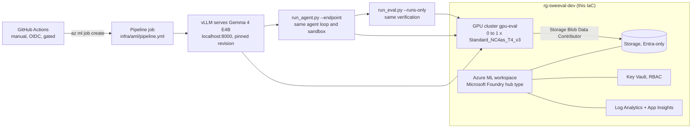

# Running the evaluation on Azure ML / Microsoft Foundry (written, not run)

Nothing here has been deployed. The IaC is checked in CI (`terraform validate` and `test` with mocked
providers, `tflint`, `checkov`, `bicep build`), and the deploy workflow is switched off.

## Target design

The pipeline runs the same code as the local run. The only change is the model client: instead of
llama.cpp, `sweval/llm_http.py` talks to vLLM's OpenAI-compatible endpoint on the same node. The
endpoint listens on localhost only, so nothing is exposed. Verification and the sandbox are unchanged.

| Resource | Terraform | Bicep |
|---|---|---|
| Log Analytics + Application Insights | `azurerm_*` | same ARM types |
| Storage (TLS 1.2, no shared keys, no public blobs) | `azurerm_storage_account` | `Microsoft.Storage/storageAccounts` |
| Key Vault (RBAC, purge protection) | `azurerm_key_vault` | `Microsoft.KeyVault/vaults` |
| Azure ML workspace (identity access to storage) | `azapi_resource` (2025-06-01) | `workspaces@2025-06-01` |
| GPU cluster: min 0 nodes, idle 2 minutes, no SSH, local auth off | `azapi_resource` (`computes@2025-06-01`) | `computes@2025-06-01` |
| Cluster identity -> Storage Blob Data Contributor on the workspace storage | `azurerm_role_assignment` | `roleAssignments` |
| Diagnostic settings (workspace, Key Vault) | `azurerm_monitor_diagnostic_setting` | `diagnosticSettings` |

## Cost before anyone says yes

Prices from the Azure Retail Prices API, pay-as-you-go, eastus2, checked 2026-11-09:

| Item | Price | One pipeline run |
|---|---|---|
| Cluster node, Standard_NC4as_T4_v3 Linux (4 vCPU, 28 GB, 1 x T4 16 GB) | $0.526 per hour | about $1 for a run of one to two hours |
| Same node as Spot | $0.303 per hour | cheaper, but the run can be evicted |

The cluster idles at zero nodes, so there is no always-on compute charge. Storage, Log Analytics and
Key Vault add small monthly charges. Many subscriptions start with zero quota for the NCasT4_v3 family;
a quota request may be needed. Delete the resource group to stop all charges. Check current prices and
get approval before enabling the workflow.

## Known risks in the written pipeline

- The T4 has no bf16 support, so vLLM casts the 16-bit weights to fp16. This has not been run; check
  the output quality on the dev split first.
- vLLM's own tool-calling parser is not used: the agent keeps the same JSON-in-text tool protocol as
  the CPU run, so local and cloud numbers stay comparable.

## One-time setup (only if approved)

1. Entra app registration with a federated credential for this repo's `dev` environment.
2. Contributor on one resource group.
3. Repository variables `AZURE_CLIENT_ID`, `AZURE_TENANT_ID`, `AZURE_SUBSCRIPTION_ID`.
4. A required reviewer on the `dev` environment.
5. `DEPLOY_ENABLED=true`, then run **deploy** by hand.

## Planned, not built

Gemma 4 E4B and larger sizes measured on the GPU node, native tool calling through vLLM, private
networking, and a scheduled weekly run that compares cloud and local results.
