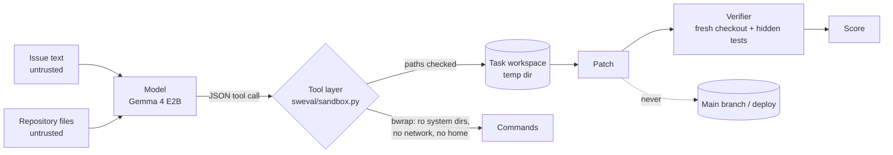

# Threat model

A coding agent is a model that can run commands and change files. The design assumes the model can be
wrong, confused, or steered by text in the repository it reads, and puts the controls in the tools
rather than in the prompt.

## OWASP Top 10 for LLM applications (2025)

| Risk | How it shows up here | Control | Evidence |
|---|---|---|---|
| LLM01 Prompt injection | A comment or README in the repository tells the agent to run something or write elsewhere | Tools refuse paths outside the workspace; commands run without network and without the host's home or other repos; the allowlist fallback has no shell | `test_an_injected_instruction_cannot_reach_the_network_or_leave_the_workspace`, `test_bwrap_mode_hides_the_host_blocks_network_and_keeps_writes_in_the_workspace` |
| LLM02 Sensitive information disclosure | The agent reads secrets from the host and writes them into a patch that is published | Only system directories and the Python environment are mounted in the sandbox; gitleaks over history; every trajectory checked for paths outside the workspace | `test_no_trajectory_touched_paths_outside_the_workspace` |
| LLM03 Supply chain | Swapped model weights or action versions | Weights pinned by revision and SHA-256, GGUF only; actions pinned to SHAs; Dependabot | `test_models_file_pins_every_model`, `test_all_actions_pinned_to_full_sha` |
| LLM05 Improper output handling | A malformed or hostile patch, or a reply that is not a tool call | Replies are parsed as JSON data, never executed as code; patches go through `git apply` on a throwaway checkout; edits to tests are reset before scoring | `test_parse_call_*`, `test_editing_tests_is_detected_and_undone` |
| LLM06 Excessive agency | The agent merges, deploys, or edits the tests to make them pass | The agent has six tools and none of them push, merge or deploy; it only hands back a patch; test edits are undone and flagged | `test_unknown_tools_and_bad_arguments_return_errors_not_exceptions`, `test_validator_rejects_broken_packs` (unknown tools) |
| LLM09 Misinformation | A patch that makes the issue's test pass but breaks something else, reported as a fix | A hidden whole-package regression suite runs on every patch; the report shows what the weaker grader would have said | `test_constant_hack_passes_the_issue_test_but_fails_the_regression_suite` |
| LLM10 Unbounded consumption | Loops that never submit, huge outputs | Turn, tool-call, token and time budgets; output caps; the context guard stops before overflow | `test_turn_limit_and_budget_message`, `test_context_guard_stops_before_overflowing` |

LLM04 (data and model poisoning), LLM07 (system prompt leakage) and LLM08 (vector and embedding
weaknesses) have no meaningful surface here: no training, no secrets in the prompt, and no retrieval.

## STRIDE for the run itself

| Threat | Example | Control |
|---|---|---|
| Spoofing | A job pretending to be the deploy pipeline | OIDC federated login, no client secret, required reviewer |
| Tampering | A changed trajectory to raise the score | Hash manifest; CI re-applies every patch and recomputes every verdict |
| Repudiation | Not knowing what the agent did | Every tool call is recorded in the trajectory (tool, arguments, ok) |
| Information disclosure | Host files read by a model command | bwrap mounts; no home directory; no network |
| Denial of service | A command that hangs | 60 s per command, 120 s per test run, budgets per task |
| Elevation of privilege | Escaping the workspace | Path resolution checks, read-only system mounts, user namespaces with nothing shared |

## Residual risks

- bubblewrap is not a security boundary against a kernel exploit. For untrusted code at scale, use a
  VM or gVisor per task.
- `/etc` is mounted read-only inside the sandbox so tools work; it holds no secrets on this machine, but
  check that on any other host.
- The first measured configuration started with an earlier sandbox that mounted the whole host
  read-only (still no network, still only the workspace writable). The mounts were narrowed while it
  ran. Every committed trajectory was checked: no command or path referred to anything outside the
  workspace.
